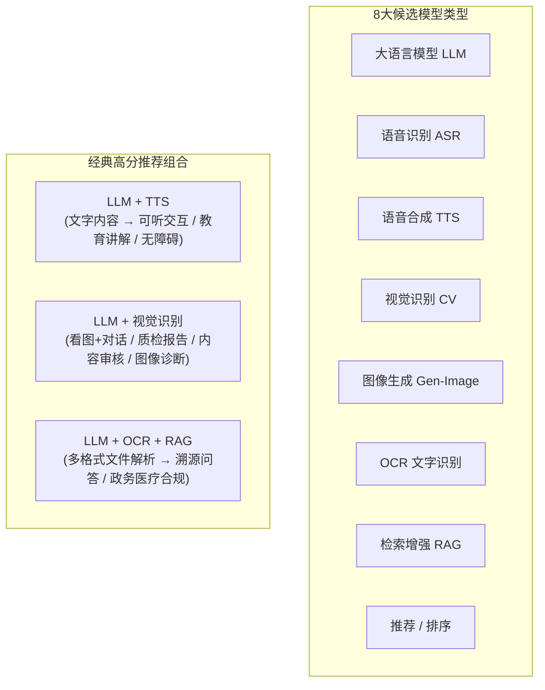
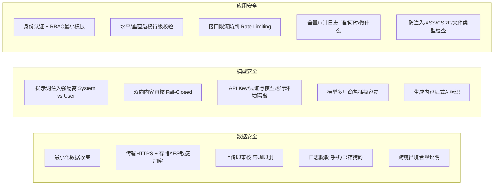

# 竞赛核心技术要求与全流程备赛指南

> 本指南根据 `docs/snapshot/` 中的竞赛技术规程（共 8 张核心要求截图）系统梳理提炼而成，涵盖**评分细则、红线否决项、模型约束、三维安全架构、七步开发流程、路演答辩与验收自检标准**，作为后续选题探讨、技术架构设计与开发落地的主参考基准。

---

## 一、 竞赛全景与核心胜负手（评分规则拆解）

### 1. 评分权重分布（满分 100 分）
评审由 **结果评分 + 安全扫描评分 + 现场路演评分** 三部分综合确定：

| 序号 | 评分项名称 | 分值 | 权重占比 | 核心考察点 |
| :--- | :--- | :---: | :---: | :--- |
| **1** | **场景功能完备性** | **30 分** | **30%** | 业务闭环度、痛点真实性、解决问题深度 |
| **2** | **安全防护水平** | **25 分** | **25%** | **同分第一比对项！** 赛前自动化扫描 + 现场抽测验证 |
| **3** | **AI 模型优化设计** | **20 分** | **20%** | 多模型协同、选型合理性、调优与提示词工程、可替换性 |
| **4** | **展演水平** | **15 分** | **15%** | 10 分钟路演节奏、真实运行流畅度、问答专业度 |
| **5** | **创新设计水平** | **10 分** | **10%** | 场景切入点新颖性、架构巧思（如状态回放、确定性输出） |
| **合计** | - | **100 分** | **100%** | - |

> 💡 **同分决胜法则**：
> 当队伍总分相同时，依次对比：**① 安全防护水平（高者优先）** → ② 场景功能完备性 → ③ AI 模型优化设计 → ④ 创新设计水平 → ⑤ 展演水平。
> **安全防护水平（25分）是进入顶尖排名的首要分水岭。**

---

### 2. 三大红线与否决项（触之即重罚 / 淘汰）
* 🔴 **否决项 1（模型不足）**：集成 AI 模型类型 **少于 2 种** $\rightarrow$ 场景功能完备性子项计 **0 分**。
* 🔴 **否决项 2（无法安全扫描）**：未按时提交完整源代码导致无法进行赛前安全自动化扫描 $\rightarrow$ 安全防护水平模块计 **0 分**。
* 🔴 **否决项 3（作假欺诈）**：发现**抄袭、套壳、虚假演示（如录屏播放、Mock伪造假数据）** $\rightarrow$ **直接取消评奖资格**。
* 🔴 **格式合规禁忌**：提交材料（源码、说明书、安全专项书）**严禁出现学校、队伍、成员姓名、导师姓名**，必须且只能使用**“参赛编号”**，违规署名视为弃权。

---

## 二、 赛题选题与模型约束

### 1. 赛题性质：开放性命题
* **形式**：题目自主选择，但“约束”是硬性的，现场每一项都要可被代码级核验。
* **推荐行业赛道**：
  * 智慧教育、智能制造、智慧医疗、数字政务、跨境电商、智慧农业等。
  * **加分鼓励方向**：跨国跨境场景（如跨境贸易 AI 合规审查、多语种智能教育平台、国际供应链安全检测等）。

### 2. 模型硬约束：必须不少于 2 类
从以下 8 类 AI 模型类型中**至少选择 2 类**（支持本地部署或云端 API 调用）：



> ⚠️ **评委审核重点**：
> 每一类模型都必须**真实参与业务流程**（有明确的输入、输出并在前端体现结果），严禁仅在架构图上做摆设。现场核验会对照源代码与调用链路逐一核对。

---

## 三、 安全架构设计（25分核心得分点，写得出、跑得动、查得到）

官方评分依据国家标准与国际标准：
`GB/T 8566`、`ISO/IEC 25010`、`GB/T 45288 (大模型)`、`ISO/IEC 42001`、`GB/T 45654 (生成式AI安全)`、`ISO/IEC 27001`、`ISO/IEC 23894 (风险管理)`。

必须在以下三个维度落实并在《安全架构专项设计说明书》中详细体现：



### 关键机制设计要求：
1. **四道内容安全闸门（Fail-Closed，失败即拦截）**：
   * **上传**：文件/图片上传阶段触发视觉审核，不合规立刻删除。
   * **提交**：文本预检，命中敏感词直接不建任务。
   * **入口**：模型前置拦截（提示词注入攻击防御）。
   * **出口**：模型输出全量复审 + 抽帧视觉复核。
   * **降级原则**：审核服务不可用时，**严禁放行**，必须显式标注系统降级状态（如 `degraded: true`）。
2. **密钥管理**：源码中绝对不能搜到明文 Key，必须服务端托管、AES-256 加密落库或走环境变量注入。

---

## 四、 研发全流程与产物交付（从 0 到交付七步法）

| 步骤 | 步骤名称 | 核心动作 | 对应阶段性产物（直接复用为说明书章节） |
| :---: | :--- | :--- | :--- |
| **01** | **定场景** | 找真实行业痛点，说明“谁在什么情况下解决什么” | 《一页场景与痛点说明》 |
| **02** | **拆功能** | 提炼 3~5 个核心功能，明确标注哪些现场真跑 | 《功能清单（标注现场真跑项）》 |
| **03** | **定模型** | 选定 ≥2 类模型，明确输入输出与交互链路 | 《模型清单与数据流图》 |
| **04** | **选工具** | 选定前后端技术栈、AI Agent 编排工具、人员分工 | 《开发工具与队内分工表》 |
| **05** | **接模型** | 封装统一接入层 + 密钥服务端托管 + 优雅降级策略 | 《接口表 + 密钥管理方案》 |
| **06** | **跑验收** | 正常流 + 边界异常流全量覆盖测试 | 《验收记录（含异常路径测试）》 |
| **07** | **补安全与文档** | 编写三维安全专项说明书与 10 分钟路演脚本 | 《安全设计说明书》+《路演脚本》 |

### 核心研发准则：
* **最小可用优先 (MVP)**：先打通最简链路 `输入 -> 模型 -> 输出 -> 界面`，切忌首个版本就铺大摊子。
* **验收驱动开发**：需求描述清晰明确（角色场景、输入输出、边界约束、逐条可勾选的验收标准）。

---

## 五、 现场路演答辩与应急保障（决胜现场）

### 1. 竞赛现场时间与环节
* **总时长**：不少于 8 小时（含准备、评审、展示与深度问辩）。
* **路演答辩**：严格计时 **10 分钟演示 + 5 分钟问答**（超时扣分）。
* **加试与抽测**：
  * 针对前列优秀队伍，裁判可增设 **10 分钟深度技术问辩**（创新、落地规划、安全完整性、模型调优）。
  * 现场将随机抽取 **10% 队伍进行安全功能实测**（5 分钟/队）。

### 2. 10 分钟路演时间预算黄金分配

```mermaid
gantt
    title 10分钟路演黄金时间分配 (单位: 分钟)
    dateFormat  m:s
    axisFormat  %M:%S
    
    场景与痛点 (1.5m)        :a1, 00:00, 01:30
    现场实跑演示 (4.5m)       :a2, after a1, 04:30
    架构与多模型 (2.0m)       :a3, after a2, 02:00
    安全防护设计 (1.5m)       :a4, after a3, 01:30
    价值与落地展望 (0.5m)     :a5, after a4, 00:30
```

### 3. 现场必带三件套（防现场翻车神兵）
1. **离线/缓存演示包**：预置典型输入样例与缓存响应，即使赛场 Wi-Fi 彻底瘫痪，也能完整走完端到端流程。
2. **一键启动脚本**：一条命令拉起所有服务（如 `docker compose up -d` 或 `sh start.sh`），不依赖复杂的逐个手动配置。
3. **冒烟自检脚本**：提供 `node scripts/smoke.mjs` 等自检工具，路演前 10 分钟快速核验环境、依赖、数据写权限、API Key、本地兜底链路。
4. **备用硬件**：笔记本电脑、随身 5G 手机热点、HDMI/Type-C 转接头。

---

## 六、 提交前“60秒安全自检”清单

在作品打包交付前，必须执行以下 6 项自查并逐项确认：
- [ ] **源码搜不到明文 Key**：代码库全局 grep 无硬编码密钥与敏感凭证。
- [ ] **未登录接口全拦截**：未携带合规 Token 时，无法调通任何业务接口。
- [ ] **越权访问拦截**：伪造用户 ID 或租户 ID 访问他人数据时被 403 严正拒绝。
- [ ] **日志脱敏合规**：终端和日志文件中手机号、邮箱、身份证均经过掩码脱敏。
- [ ] **内容安全审核失败拦截**：将审核服务断开，系统执行 Fail-Closed 拦截并提示降级，而非放行。
- [ ] **说明书可定位**：在《安全架构专项设计说明书》中，上述每一项防护都能精确找到对应的代码实现位置与文件路径。
