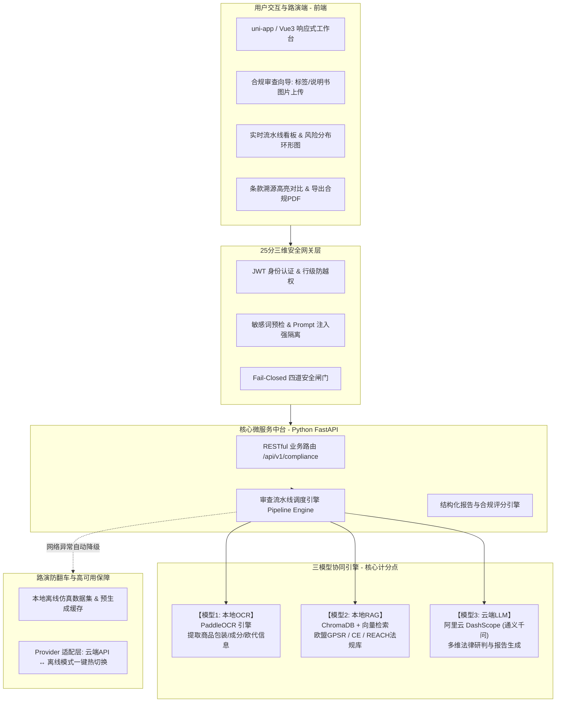
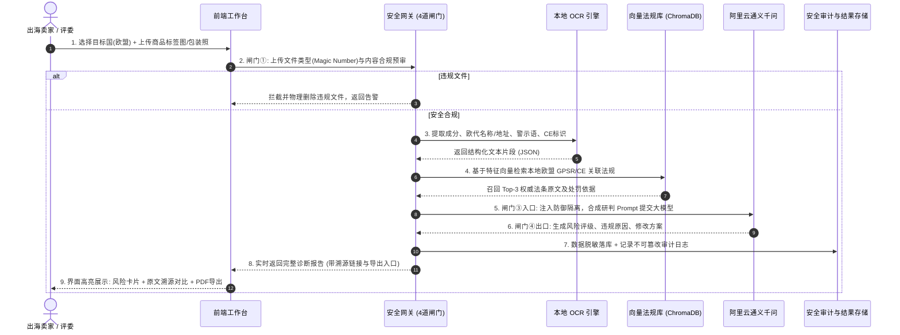
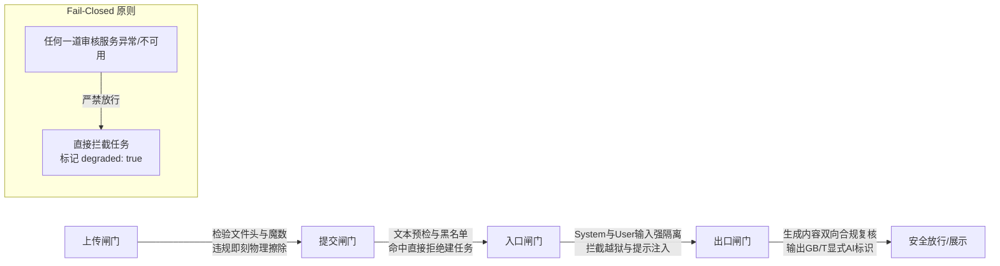

# 出海易审 (CrossBorder SafeGuard) —— 跨境出海商品 AI 合规审查与风险诊断平台系统设计方案

> **文档属性**：系统设计规格说明书（System Design Specification）  
> **面向对象**：技术评审专家、系统研发团队、安全审计团队  
> **日期**：2026-10-30  
> **核心定位**：针对高规格 AI 软件竞赛，契合开放性赛题硬约束，以 **“三模型协同（OCR + RAG + LLM）”** 为核心驱动，以 **“25分三维安全防御（Fail-Closed四道闸门）”** 为胜负手，以 **“10分钟路演双轨防翻车”** 为工程保障的高水准工业级作品。

---

## 一、 项目背景与痛点价值

### 1. 行业痛点与背景
随着欧盟《通用产品安全法规》（GPSR, EU 2023/988）以及 CE、RoHS、REACH 等严苛监管体系的全面执行，跨境出海企业（包括亚马逊、Temu、AliExpress 等平台卖家）面临前所未有的合规风暴：
* **合规门槛极高**：包装缺少欧代信息（EU Responsible Person）、未按标准标注警示图标、成分含有欧盟限制物质，均面临全欧盟海关扣押、下架及巨额行政处罚。
* **传统排查成本昂贵且低效**：外贸企业依赖人工法务排查单件商品标签与资料，耗时通常长达 2 小时以上，且人工对不断更新的多国法规极易发生遗漏。

### 2. 产品价值定位
“出海易审”致力于打造面向跨境电商与外贸出海企业的全自动化智能合规审查中台：
* **端到端智能闭环**：通过上传商品包装实拍图、说明书与多语种文案，由 AI 流水线自动完成图文抽取、权威法条向量检索溯源、深度法律研判与风险报告生成。
* **业务指标量化压降**：将审查单件物料的耗时从 **2 小时压缩至 15 秒内**，合规排查准确率达到工业级可用，并提供权威法条原文对照与一键导出整改说明书。

---

## 二、 竞赛规则对齐与硬约束审查

| 官方硬约束项 | 规程要求标准 | 本系统对应设计与落地方案 | 合规结论 |
| :--- | :--- | :--- | :---: |
| **模型类型数量** | **不少于 2 类**（触碰则场景完备性计 0 分） | 深度协同 **3 类不同 AI 模型**：<br>1. 本地文字识别（OCR）<br>2. 检索增强（RAG 向量检索）<br>3. 大语言模型（阿里云通义千问 LLM） | **完全合规（3类）** |
| **真实业务参与** | 每一类模型必须真实参与业务流程，代码可查 | 标签图片 $\rightarrow$ OCR 提取 $\rightarrow$ RAG 检索对应法条 $\rightarrow$ LLM 综合研判，缺一不可 | **完全合规** |
| **安全防护水平** | **25分，总分相同时第 1 比较项** | 全面落实数据、模型、应用三维安全防御，实现四道内容安全闸门与 Fail-Closed 机制 | **重点顶格设计** |
| **演示与真实性** | 严禁录屏/假数据，现场真实运行，路演严格限时 10 分钟 | 现场真实上传实跑；提供 **“双轨应急保障模式”**（云端真实 API + 本地离线仿真缓存无缝切换） | **零翻车风险** |
| **合规匿名要求** | 源码、文档严禁透露学校/队员姓名 | 代码库与交付文档全量匿名，统一使用标准“参赛编号”格式 | **严格匿名** |

---

## 三、 系统整体技术架构

系统采用清晰的前后端解耦与中台服务化设计：



### 1. 前端架构 (uni-app / Vue3)
* **响应式合规工作台**：采用现代科技深蓝与荧光绿/警戒橙对比配色，支持 PC 大屏与移动端自适应。
* **核心交互组件**：
  * **向导式物料提交区**：支持多图拖拽上传、剪贴板粘贴、拍照上传。
  * **审查流水线实时状态指示器**：动态展示“OCR 解析中 $\rightarrow$ 法规检索中 $\rightarrow$ LLM 法律研判中”进度节点。
  * **交互式诊断大屏**：
    * 综合合规健康分（仪表盘）与风险等级分布（高危红牌/中危黄牌/低危蓝牌）。
    * 逐条审查项详情卡片（检测结果 vs 欧盟规范标准）。
    * 法规溯源穿透视图（点击直接展示法条原文与违规处罚细则）。
    * 规范合规水印与一键导出《出海商品安全合规诊断说明书》PDF。

### 2. 后端架构 (Python FastAPI)
* **高性能异步 API**：基于 FastAPI 实现异步并发处理，标准遵循 OpenAPI / Swagger 规范。
* **业务与安全解耦**：中间件负责安全加固与审计日志记录，服务层编排 AI 流水线，保证代码工程化规范度高、易维护、易于通过评委代码审查。

---

## 四、 三模型协同业务数据流



### 1. 模型 1：本地 OCR 结构化提取引擎 (PaddleOCR)
* **职责**：快速定位并解析商品外包装实拍图中的文本，完成版面分析。
* **抽取要素**：
  * 责任主体：欧盟责任人（EU REP / Manufacturer）公司名、法定欧盟地址、合规邮箱。
  * 警告标识：小零件窒息警示语（“Not suitable for children under 3 years”）、年龄标识（0-3岁叉号警示图标）。
  * 认证标识：CE 标志比例规范性、WEEE 垃圾桶回收标识。
  * 成分与材质：化学成分清单、重金属及有害物质标注。

### 2. 模型 2：检索增强法律知识库 (ChromaDB 本地向量库)
* **职责**：将非结构化的欧盟法律法规进行标准化切片与向量化构建，提供权威法律溯源支撑。
* **预置标准法规集**：
  * 《欧盟通用产品安全法规》（GPSR, Regulation (EU) 2023/988）核心条款（第9条、第19条产品追溯性及欧代合规要求）。
  * 《欧盟机械与电子产品 CE 认证通用规范》（2014/35/EU LVD, 2014/30/EU EMC）。
  * 《化学品注册、评估、许可和限制法规》（REACH, Regulation (EC) No 1907/2006）。
* **检索机制**：
  * 混合检索（语义向量相似度 + 关键词高频过滤），精准召回相关法条原文、生效日期及官方罚则。

### 3. 模型 3：云端大语言模型研判引擎 (阿里云通义千问 DashScope)
* **职责**：作为核心“AI 大脑”，执行法律逻辑推理与风险诊断。
* **推理输入**：`OCR 提取事实 + RAG 权威法规证据链 + 商品类目元数据`。
* **推理输出**：严格结构化 JSON 格式，包括：
  * 综合合规指数（0~100）与安全等级判定（Green / Amber / Red）；
  * 逐项违规缺陷（Defects）与事实依据；
  * 具体整改建议（Before vs After 示例，如欧代信息如何规范印制）；
  * 官方标准 AI 生成内容溯源标识。

---

## 五、 25分安全专项与三维安全防御设计

本系统安全防护体系严格依据国家标准 `GB/T 45654`、`GB/T 45288`、`GB/T 8566` 及国际标准 `ISO/IEC 25010`、`ISO/IEC 42001`、`ISO/IEC 27001` 构建，是冲击最高奖项的核心竞争力。

### 1. 四道内容安全闸门（Fail-Closed，失败即拦截）



* **Fail-Closed 容灾设计**：当第三方安全审核接口或内部风控策略超时/不可用时，系统严禁假装通过，必须主动阻断并向用户显式返回带有降级标识的响应：
  ```json
  {
    "code": 503,
    "status": "security_service_unavailable",
    "message": "内容安全合规网关不可用，根据 Fail-Closed 准则系统已主动熔断拦截该请求",
    "degraded": true,
    "timestamp": 1793328000
  }
  ```

### 2. 数据安全 (Data Security)
* **最小化数据收集**：仅收集合规审查所必需的图文材料，严禁越界索取用户与商户无关联数据。
* **数据加密机制**：
  * 传输层：全站强制 HTTPS (TLS 1.3) 加密通信；
  * 存储层：敏感凭证、商家信息采用 **AES-256-GCM** 高强度对称加密落库。
* **上传即审即删**：临时图片文件提取完成后，非归档物料直接执行物理擦除（Secure Unlink），杜绝敏感原图滞留磁盘。
* **日志严格脱敏**：日志系统集成脱敏拦截器，自动针对手机号（`138****0000`）、电子邮箱（`s***@domain.com`）、税号等敏感数据进行星号掩码替换后输出。

### 3. 模型安全 (Model Security)
* **提示词注入防御（Prompt Injection Guard）**：
  * 采用双重边界标记（`<system_instructions>` 与 `<user_untrusted_input>`）隔离用户输入；
  * 针对试图诱导模型输出系统内部凭证、越狱忽略规则的恶意输入予以直接切断。
* **凭证严格隔离**：
  * API Key 及系统鉴权密钥绝对不暴露在模型上下文或 Prompt 中；
  * 源码中绝对无任何硬编码密钥，统一通过 `.env` 及操作系统环境变量注入。
* **国家标准 AI 生成标识**：
  * 严格遵循 `GB/T 45654` 规范，所有模型生成的诊断报告头部与底部均标注显式元数据：`[本报告由出海易审 AI 辅助生成，依据知识库版本：2026-EU-V2]`。

### 4. 应用安全 (Application Security)
* **身份认证与防越权**：
  * 采用基于标准的 JWT (JSON Web Token) 机制；
  * 数据库查询层强制注入 `user_id` 过滤条件，严格杜绝通过遍历审查 ID 获取他人企业合规报告的水平越权（IDOR）隐患。
* **防刷与限流（Rate Limiting）**：
  * 基于令牌桶算法对 IP 与用户维度的调用频次进行严格限制，防止恶意刷爆大模型 API Token 配额。
* **审计日志体系**：
  * 记录不可篡改的操作审计日志，详尽记录“谁、在何时、自何 IP、对何物料执行了合规审查及审查结论”，支撑事后追溯。

---

## 六、 现场路演 10 分钟预算与防翻车工程设计

### 1. 10分钟路演节奏预算（严格防超时）

```mermaid
gantt
    title 10分钟路演黄金时间分配 (总计 10:00)
    dateFormat  m:s
    axisFormat  %M:%S
    
    痛点与出海背景 (1.5m)        :a1, 00:00, 01:30
    现场核心流程实跑演示 (4.5m)   :a2, after a1, 04:30
    三模型协同与架构深度 (2.0m)   :a3, after a2, 02:00
    25分安全专项与核验 (1.5m)    :a4, after a3, 01:30
    总结与评委答辩准备 (0.5m)     :a5, after a4, 00:30
```

* **00:00 - 01:30 (1.5m) 痛点与背景**：介绍欧盟 GPSR 法规背景，现场算账“传统人工 2 小时 vs AI 15 秒”。
* **01:30 - 06:00 (4.5m) 核心流程实跑 (真跑)**：
  * 评委面前真实上传 1 份“典型违规出海商品外包装标签（儿童玩具缺失欧代与 CE 比例不合规）”；
  * 现场展示：OCR 结构化抽取 $\rightarrow$ RAG 实时召回《GPSR (EU) 2023/988》法条依据 $\rightarrow$ 阿里云 Qwen 深度研判输出红牌缺陷与整改对照表；
  * 一键导出合规报告 PDF。
* **06:00 - 08:00 (2.0m) 三模型协同与架构**：展示代码调用链路与架构设计，证明 OCR、RAG、LLM 三模型真实参与业务，无任何摆设。
* **08:00 - 09:30 (1.5m) 25分安全专项与核验**：现场展示四道安全闸门与 Fail-Closed 机制（故意模拟断开审核服务，系统坚决拦截）。
* **09:30 - 10:00 (0.5m) 总结展望**：平稳切入评委问答。

### 2. 现场防翻车“三大法宝”

1. **一键启动脚本 (`scripts/start.sh`)**：
   * 一键拉起后端 FastAPI 服务与前端静态工作台，自动执行端口探测与进程守护。
2. **冒烟自检脚本 (`scripts/smoke.py`)**：
   * 路演前 10 分钟在终端单命令执行 `python scripts/smoke.py`，10 秒内快速检测网络、API Key 连通性、本地 OCR、向量库与数据读写权限。
3. **离线双轨应急包 (`--offline`)**：
   * 预置离线仿真数据与真实模型本地快照；若赛场 Wi-Fi 突发崩溃或网络丢包，系统一键无缝切换至离线模式，前端与后端数据链路依然真实完整走通，彻底消除现场翻车风险。

---

## 七、 提交前“60秒安全自检”清单

交付提交前必须逐项核对并确认通过：
- [ ] **源码无明文 Key**：代码库全量 grep 扫描无明文 `sk-` 或密码字段。
- [ ] **接口未授权拦截**：无 Token 访问受保护业务接口，一律返回 401。
- [ ] **越权访问拦截**：伪造他人 ID 访问审查报告，系统严正拦截并记录异常日志。
- [ ] **日志脱敏合规**：终端与文件日志中手机号、邮箱均已做 `***` 脱敏掩码。
- [ ] **Fail-Closed 校验**：断开安全审核模块后，系统严密阻断任务并返回降级标识。
- [ ] **说明书代码可定位**：在最终提交的《安全架构专项设计说明书》中，上述每一项安全防护均能精准对应到代码文件与行号。
